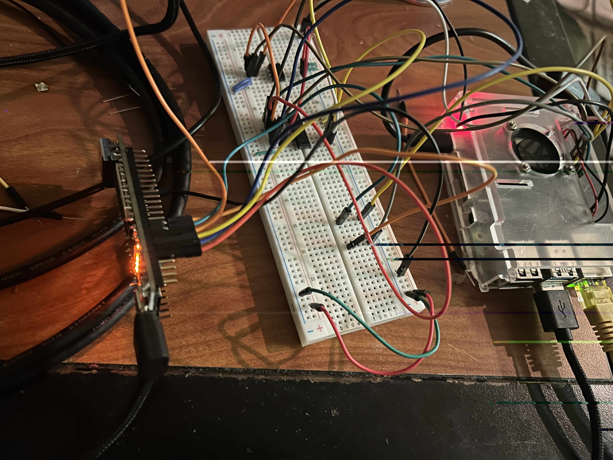

# TOGA-WA CPU

TOGA-WA is a two-stage CPU with 16-bit instructions, one 64-bit working register,
and a shared 64 KiB external memory for code and data. Its instructions toggle
bits, branch, and exchange the working register with memory.

## Architecture

- **Pipeline:** instruction fetch (IF) followed by combined execution and memory
  access (IDEXMEM).
- **Working register:** a 64-bit value, its associated memory address, and a dirty
  flag. WA and HALT write back a dirty register before completing.
- **Memory:** uncached instruction fetch and data requests share an arbiter and
  SPI master. Each instruction fetch streams two bytes; each data read or write
  streams eight bytes. Instructions and data are stored little endian.
- **Completion:** loads update the register and its address after the full
  response. HALT stays asserted until reset. Reset clears CPU state, not memory;
  an interrupted write can leave some bytes changed.

The [pipeline](rtl/togawa.sv), [arbiter](rtl/spi_arbiter.sv), and
[SPI master](rtl/spi_master.sv) connect in [main_module](rtl/main_module.sv).

## ISA

`R` is the working register. The program counter counts 16-bit instruction words.

| Instruction | 16-bit encoding | Operation |
| --- | --- | --- |
| TOGA | `0`, bit index `[14:9]`, signed offset `[8:0]` | Toggle `R[bit]`; if it becomes zero, branch relative to the following instruction. |
| WA-direct | `10`, word index `[13:0]` | Write back dirty `R`, then load eight bytes from `index << 3`. |
| WA-indirect | `11`, ignored `[13:0]` | Write back dirty `R`, then load eight bytes from the old value of `R << 3`. Canonical encoding: `0xC000`. |
| HALT | `0x0000` | Complete dirty writeback and stop. |

TOGA selects bits 0–63 and branches by −256 to +255 instructions. `0x0000` is
reserved for HALT, so TOGA bit 0 with offset 0 cannot be encoded.

SPI byte addresses wrap at 16 bits. Instruction fetch uses `(PC << 1) & 0xFFFF`;
WA uses `(index << 3) & 0xFFFF`, so data words are eight-byte aligned and only the
low 13 index bits affect the address. Reset initializes `PC`, `R`, and the
associated data address to zero.

## Results

The [program datasets](dv/cocotb_benches/programs/) use the
[TOGAWA assembler](dv/cocotb_benches/programs/generate.py). These benchmarks use
8-bit arithmetic modulo 256; Minsky interprets coordinate bytes as signed values
and uses a step factor of 1/16.

| Program | Input | Result |
| --- | --- | --- |
| Incrementer | 255 + 1 | 0 |
| Adder | 127 + 129 | 0 |
| Fibonacci | F(13) | 233 |
| Fibonacci overflow | F(14) | 121 |
| GCD | 255, 251 | 1 |
| LFSR | Seed 255, 255 steps, mask `0xB8` | 255 |
| Minsky circle | Start `(64, 0)`, 100 steps | `(63, -4)` |

## Progress:

- **RTL simulation at 50 MHz:** 21/21 integrated cases passed, covering all 17
  programs, memory access, interrupted transfers, and asynchronous reset.
- **FPGA execution:** 17/17 programs reached HALT and matched their expected
  memory contents, including Minsky circle.

FPGA checks cover HALT and external memory results; internal register and branch
checks are performed in simulation.

- **GF180 Tapeout:** I am aiming for GF180 tapeout service provided by tiny tapeout,
   and the deadline for design submission is Dec this year, while the actual chips 
      will arrive in May next year(2027)
